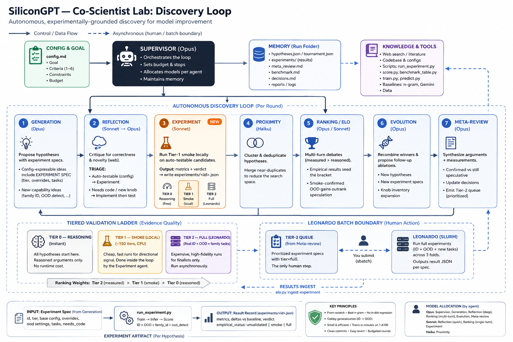

# Co-Scientist Lab

> A **measurement-grounded multi-agent discovery engine** — a faithful replica of Google's
> **AI Co-Scientist**, extended with an **Experiment agent** that *actually runs* every promising
> hypothesis in **your** project, so the tournament ranks ideas on **measured results, not just argument**.

[](LICENSE)


Instead of answering a hard, open-ended question *once*, a **team of specialized agents** keeps
**generating → reviewing → experimenting → Elo-ranking → evolving** candidate solutions, while a
**meta-review** feeds the round's lessons back into every agent. You choose how long it runs: a fixed
number of rounds, or **until your target metric is reached**.


<sub>Diagram generated with an AI image model.</sub>

---

## Install

```
/plugin install co-scientist-lab --marketplace Jaseelkt007/co-scientist
```

Or in two steps (inside Claude Code, or prefix with `claude` in your shell):

```
/plugin marketplace add Jaseelkt007/co-scientist
/plugin install co-scientist-lab@jaseel-plugins
```

Requires Python 3 (standard library only) and, for code-change experiments, git. The same marketplace
also has the lighter, reasoning-only [`co-scientist`](https://github.com/Jaseelkt007/co-scientist) plugin.

> **Upgrading from the old `git clone ~/.claude/skills/co-scientist-lab` install?** Delete that folder
> and install the plugin instead — the skill now lives under `skills/co-scientist-lab/`.

---

## Use it

Open Claude Code **in the project you want to improve** and describe the goal:

> *"Run a co-scientist-lab discovery loop: improve validation accuracy of this model without slowing
> inference."*
>
> *"Use co-scientist-lab to cut p95 latency of the `/search` endpoint — benchmark is `make bench`."*

Or invoke it directly: `/co-scientist-lab:co-scientist-lab <goal>`.

### 1. It adapts itself to your project (a few questions, once)

Before round 1 it **reads your repo** — README, Makefile/`package.json` scripts, train/eval/benchmark
entry points, configs, prior results — and dry-runs the obvious command to see real output. Then it asks
two short rounds of multiple-choice questions, with its own guesses pre-filled:

| It asks | For example |
|---|---|
| Run real experiments, or reasoning only? | run experiments |
| How may an idea change the project? | config/CLI parameters only · code changes in throwaway git worktrees · I run them myself (cluster) |
| When should it stop? | target reached or N rounds · exactly N rounds · on plateau |
| Pause between rounds? | pause for review · fully autonomous |
| Which command measures one candidate? | `python train.py {args} --out {out_dir}` |
| Which number decides, higher or lower better? | `val_acc ↑` |
| What counts as success? | `+5% over baseline` |
| Maximum rounds? | 5 |

It then confirms **guardrails** (metrics that must not get worse), **frozen paths** (evaluation code and
test data — ideas can never win by changing what is measured), timeouts, a cheap *smoke* tier vs a
faithful *full* tier, and metric noise. Everything goes into one `lab.json`, and it **measures your
baseline** before starting.

### 2. Rounds

**Generation** proposes testable ideas → **Reflection** reviews and filters → **★ Experiment** applies
each idea (config overrides, or a code change in an isolated worktree) and runs your command →
**Proximity** de-dupes → **Ranking** runs an Elo tournament where *measured beats reasoned* →
**Evolution** recombines winners → **Meta-review** distills lessons for the next round.

After each round you get a one-line status:

```
round 2/5 · best val_acc 0.758 (h3, smoke) vs baseline 0.676 → target 0.78 (79% of the way)
experiments: 4 (✓2 ✗1 ~1) · top Elo 1288 · continue
```

### 3. Stopping — deterministic, your rule

`elo.py lab-status` decides after every round: **target reached**, **max rounds**, **experiment
budget used**, or **plateau** (no improvement beyond noise for *k* rounds).

### 4. Output

A ranked shortlist with each idea's **measured** result, a research overview, and for every measured
winner a way to reproduce it: the overrides file, or a `change.patch` you can `git apply`. Your working
tree is never modified unless you ask.

All state is plain files under `.coscientist_runs/<slug>/` — runs survive interruptions and resume.

---

## What makes it a "lab" — the Experiment agent ★

The base Co-Scientist ranks ideas by *argument*. Co-Scientist Lab adds an 8th agent that **runs** them
through a generic harness ([`run_experiment.py`](skills/co-scientist-lab/scripts/run_experiment.py)):

- **Any command, any metric** — read from stdout (regex) or a JSON/text file the command writes.
- **Baseline + noise** — the baseline can be repeated to measure noise; a gain inside the noise band
  counts as *neutral*, not a win.
- **Guardrails** — a gain that breaks a guardrail metric is marked `regresses-guardrail`.
- **Anti-gaming** — in code mode the diff is captured; touching a frozen path makes the result
  `touched-frozen` and it is never run.
- **Tiers** — cheap smoke runs for every candidate, full runs for finalists only; a tier can be
  `manual` (e.g. Slurm) — it renders the command, you run it, and it ingests your log or numbers.
- **Timeouts** that kill the whole process group, so runaway training jobs don't linger.

## The agent roster (8)

| Agent | Role |
|---|---|
| 🧭 **Supervisor** | Adapts the lab to your project; orchestrates rounds; applies the stop rule. |
| 💡 **Generation** | Proposes novel, *testable* hypotheses with a falsifiable prediction. |
| 🔍 **Reflection** | Peer-reviews & filters; triages testable-now vs needs-code. |
| 🧪 **Experiment ★** | Applies the idea and runs your harness → a measured result. |
| 🧲 **Proximity** | Clusters / de-duplicates hypotheses. |
| 🏆 **Ranking** | Elo tournament (pairwise debate); measured > reasoned. |
| 🧬 **Evolution** | Recombines/refines measured winners into new hypotheses. |
| 📝 **Meta-review** | Tracks progress to target; confirmed vs refuted; feeds every agent. |

---

## Worked example — it designed a real model

This engine designed the architecture of **[SiliconGPT](https://github.com/Jaseelkt007/SiliconGPT)** —
a 1.37M-parameter, from-scratch transformer for semiconductor **process logic**. Over two rounds it
tested **eight design levers, rejected five with measured negatives**, and found a counter-intuitive
winner: *shrinking* the model improved out-of-distribution generalization. That setup, expressed in
today's `lab.json` format, is in [`examples/silicongpt/`](examples/silicongpt/).

---

## What's in here

```
.claude-plugin/plugin.json      plugin manifest
skills/co-scientist-lab/
  SKILL.md                      the Supervisor's playbook (setup → rounds → stop → handoff)
  agents/                       8 agent personas
  references/lab-config.md      the setup interview + lab.json schema
  references/                   architecture rationale · criteria rubric · memory schema
  scripts/run_experiment.py     generic experiment harness (stdlib only)
  scripts/elo.py                tournament + state (atomic writes), ingest-experiment, lab-status
  scripts/coscientist_workflow.js   optional reasoning-only Workflow orchestration
examples/silicongpt/            worked example (lab.json, seed config, original design notes)
docs/                           the discovery-loop diagram
```

### Developing locally

```bash
claude plugin validate .
claude --plugin-dir .      # load this checkout for one session without installing
```

---

## What this plugin runs and accesses

- **Contents:** one skill (`co-scientist-lab`) made of Markdown instructions, plus three scripts. It has no
  hooks, no MCP servers and no background processes, and it installs no packages.
- **Local commands, all visible as normal Claude Code tool calls you can approve or deny:**
  - `python …/scripts/elo.py` keeps the tournament state.
  - `python …/scripts/run_experiment.py` runs experiments.

  Both use only the Python standard library and write only to `.coscientist_runs/<slug>/` in your project.
- **Your project's own command:** in measured mode, the harness runs **the command you confirmed at
  setup** (stored in `lab.json`), with your permissions, in your project folder, or, in code mode, in a
  temporary `git worktree` outside it. It never changes your working tree, and winning code changes are
  saved as patch files for you to apply yourself. Commands in a tier you mark as `manual` are only
  printed, never run.
- **Reading your repo:** during setup, Claude reads project files (README, scripts, configs, earlier
  results) to suggest the command and metric.
- **Subagents:** it starts Claude subagents through Claude Code's own `Agent` tool.
- **Network:** the plugin itself sends nothing anywhere. Agents may use Claude's built-in web search and
  fetch to check ideas against published work. Any network access your own experiment command makes is
  up to that command.
- **Data:** it has no telemetry and no analytics, and it collects no personal data. Results, logs and
  patches stay in the run folder in your project.

## Credits & attribution

- **Method:** a faithful replica + extension of **Google's AI Co-Scientist** — Gottweis et al.,
  *"Towards an AI co-scientist,"* Nature 2026 / [arXiv:2502.18864](https://arxiv.org/abs/2502.18864).
  All credit for the original multi-agent design goes to that work; this repo replicates it and adds
  the experiment-grounding layer. Not affiliated with Google.
- **The Experiment-grounding extension + this packaging:** Mohammed Jaseel Kunnathodika.
- Runs on **Claude Code** (each agent is a Claude subagent).

## License

**MIT** — see [`LICENSE`](LICENSE). Use it freely.
